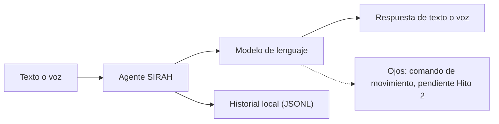

# SIRAH

S.I.R.A.H. es un robot conversacional por texto y voz, para sistemas
embebidos Linux, sin contenedores ni GPU.

**Estado actual:** la parte de texto está implementada; la voz fue validada
manualmente en una máquina; los ojos/servos y la visión siguen pendientes de
validación física.

**Validación actual:** `make check` pasa en desarrollo local, sin hardware ni
red; `make guard` protege rutas sensibles. Ejecuta `make check` para la cifra
de pruebas actual. CI: TODO.

## Qué es SIRAH

Combina un LLM, tarjetas de personaje, memoria e historial local, texto y voz.
Las etiquetas de ojos se analizan y se descartan hoy, porque esa parte no está
validada. SIRAH no afirma acciones físicas que no ocurrieron.

## Estado del proyecto

| Hito | Estado | Detalle |
|---|---|---|
| Hito 0 | Implementado | `setup` y `doctor` |
| Hito 1 | Implementado | Texto, tarjetas y memoria |
| Hito 2 | HIL pendiente | ESP32, PCA9685 y servos |
| Hito 3 | Pendiente | Cámara y detección |
| Hito 4 | Parcial | Captura, STT, TTS y VAD |

## Tabla de contenido

- [Demo y media](#demo-y-media)
- [Arquitectura](#arquitectura)
- [Hardware](#hardware)
- [Software y requisitos](#software-y-requisitos)
- [Instalación y uso](#instalacion-y-uso)
- [Estructura de repositorio](#estructura-de-repositorio)
- [Validación](#validacion)
- [Roadmap](#roadmap)
- [Créditos y equipo](#creditos-y-equipo)
- [Licencias](#licencias)
- [Contacto](#contacto)

## Demo y media

TODO: screenshots, GIFs y fotos del montaje todavía no están disponibles.
No incluir activamente imágenes hasta tener una fuente propia y revisada.

## Arquitectura



Lee `docs/ARQUITECTURA.md` para los flujos por texto y voz, y
`docs/PROTOCOL.md` para el protocolo del firmware.

## Hardware

| Componente | Cantidad | Estado |
|---|---:|---|
| ESP32, modelo exacto por confirmar | 1 | Firmware listo; hardware sin HIL completo |
| PCA9685, dirección `0x40` | 1 | Extremos calibrados; integración pendiente |
| Servo SG90 | 6 | Calibración candidata; `TIRED` pendiente |
| Fuente externa 5 V | 1 | TODO: amperaje real medido |
| Cámara USB / V4L2 | 1 (opt-in) | Software listo; visión pendiente |
| Micrófono y altavoz | 1 de cada (opt-in) | Voz validada en una máquina |

Mecánica de ojos: EyeMech ε3.2 es una inspiración; SIRAH no incluye archivos
STL. Las licencias de esos diseños: TODO por confirmar.

## Software y requisitos

- Python 3.12, `uv`, Linux x86_64 o aarch64.
- `httpx` y `pyserial`.
- Voz opcional: `piper-tts`, ALSA.
- Una clave LLM; para STT se reutiliza Groq si el LLM ya es Groq.
- Hardware opcional con grupo `dialout`, cámara y audio.
- Sin contenedores ni GPU.

## Instalación y uso

```bash
uv sync --all-extras
uv run sirah setup
uv run sirah doctor
uv run sirah
```

```bash
uv run sirah voice
uv run sirah voice --check
uv run sirah doctor --offline
```

`sirah setup` crea `.env`, copia `config/sirah.toml.example` y ofrece voz.
`sirah doctor` no abre el serial.

## Estructura de repositorio

```text
SIRAH/
├── sirah/          # núcleo y adaptadores
├── config/         # calibración y tarjetas
├── firmware/       # ESP32 y PCA9685
├── docs/           # arquitectura, protocolo, hardware
├── tests/          # sin hardware ni red
└── .env.example
```

## Validación

- `make check`: pruebas offline, sin hardware ni red.
- `make guard`: rutas protegidas intactas.
- `voice --check`: graba 3 s y muestra RMS/VAD.
- HIL: fotos, medición, reconexión y resistencia TODO.
- Voz: pendientes VAD con ruido, corte de red y cierre limpio.

## Roadmap

- Validar servos con carga real.
- Probar `TIRED`, alimentación y reconexión.
- Implementar visión con cámara.
- Medir rendimiento en Raspberry Pi.
- Agregar panel web autenticado en un hito posterior.
- Mejorar pruebas HIL.

## Créditos y equipo

*(Aquí va: crédito de la institución, autoría y contacto vía GitHub.)*

- Proyecto: S.I.R.A.H.
- Institución: Instituto Tecnológico de Ciudad Madero (ITCM).
- Repositorio: https://github.com/Laxxup/SIRAH-Rework
- Autor y supervisor: https://github.com/Laxxup
- Taller de alumnos: Comunidad Robótica.
- Contacto: por GitHub Issues o discusiones del repositorio.
- Hardware pendiente: fotos, medición de fuente, reconexión y resistencia (HIL).

## Licencias

- Código nuevo: MIT (`LICENSE`).
- Firmware y calibración: revisa `firmware/README.md`.
- Piper y modelos: licencias propias.
- YuNet: MIT (`models/LICENSE.yunet`).
- EyeMech: solo referencia; no incluye archivos STL.

## Contacto

- Enlace al repositorio: https://github.com/Laxxup/SIRAH-Rework
- Perfil del mantenedor: https://github.com/Laxxup
